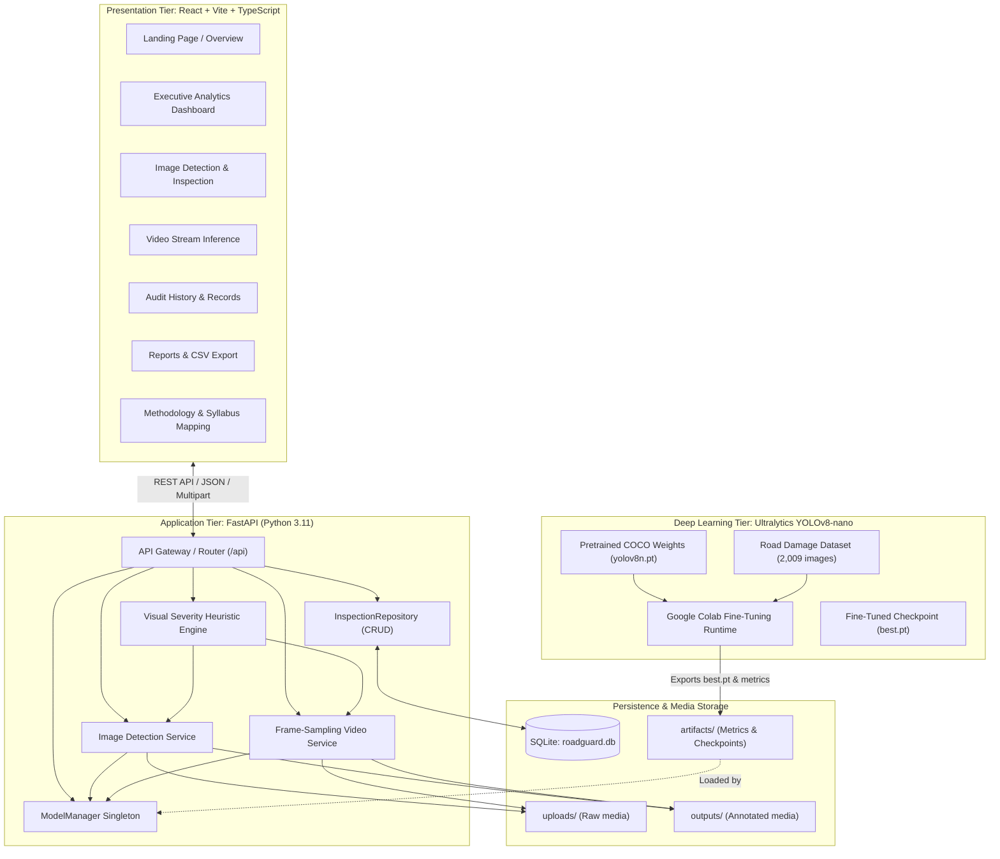
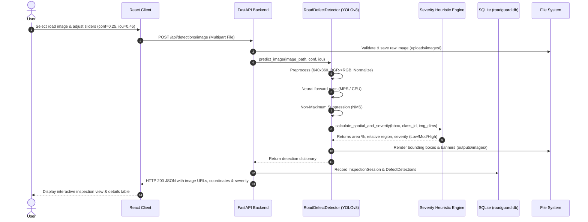
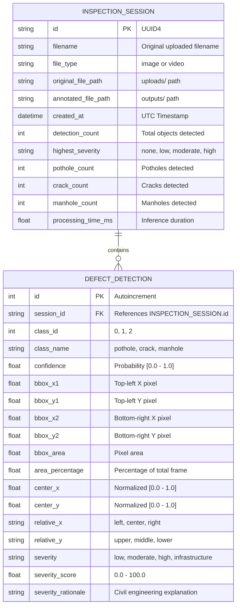

# RoadGuard AI — System Architecture & Technical Specifications

**Course:** CSE471 — Deep Learning for Computer Vision  
**Project:** Automated Road Pothole and Asphalt Crack Detection for Smart Maintenance  
**Author:** Shivam Rai  
**Target Environment:** Local Apple Silicon (MacBook Air M2, 8GB RAM) + Free Cloud GPU (Google Colab T4)

---

## 1. High-Level Architectural Overview

RoadGuard AI is designed as a decoupled, multi-tier deep learning computer vision system. It cleanly separates the computational concerns of deep learning model training (Google Colab), lightweight local inference and persistent orchestration (FastAPI + SQLite), and rich interactive presentation (React + TypeScript + Vite + Tailwind CSS).

---

## 2. Machine Learning Pipeline Architecture

The detection architecture utilizes **Ultralytics YOLOv8-nano** (`yolov8n.pt`), an anchor-free single-stage object detector optimized for real-time mobile and edge computer vision.

```mermaid
flowchart LR
    subgraph Backbone["Backbone: Modified CSPDarknet"]
        Input["Input Image (640x360x3)"] --> Conv1["Conv 3x3 (Stride 2)"]
        Conv1 --> C2f_1["C2f Block 1"]
        C2f_1 --> Conv2["Conv 3x3 (Stride 2)"]
        Conv2 --> C2f_2["C2f Block 2"]
        C2f_2 --> Conv3["Conv 3x3 (Stride 2)"]
        Conv3 --> C2f_3["C2f Block 3 (P3)"]
        C2f_3 --> Conv4["Conv 3x3 (Stride 2)"]
        Conv4 --> C2f_4["C2f Block 4 (P4)"]
        C2f_4 --> Conv5["Conv 3x3 (Stride 2)"]
        Conv5 --> C2f_5["C2f Block 5 (P5)"]
        C2f_5 --> SPPF["Spatial Pyramid Pooling Fast"]
    end

    subgraph Neck["Neck: PAN-FPN Feature Fusion"]
        SPPF --> TopDown["Top-Down Upsampling"]
        TopDown --> Concat1["Feature Concatenation"]
        Concat1 --> BottomUp["Bottom-Up Path Aggregation"]
    end

    subgraph Head["Decoupled Anchor-Free Detection Head"]
        BottomUp --> ClsBranch["Classification Branch (BCE Loss)"]
        BottomUp --> BoxBranch["Box Regression Branch (CIoU + DFL Loss)"]
        ClsBranch --> PostProcess["NMS & IoU Filtering (Conf ≥ 0.25, IoU ≤ 0.45)"]
        BoxBranch --> PostProcess
        PostProcess --> Detections["Final Bounding Boxes [x1, y1, x2, y2]"]
    end
```

### Architectural Highlights
1. **C2f Modules:** Replace earlier C3 modules by combining high-level features with contextual information through gradient-split cross-stage pathways, increasing gradient flow and representational capacity without increasing FLOPs.
2. **Anchor-Free Head:** Eliminates predefined anchor boxes. Direct prediction of bounding box centers and offsets reduces task misalignment and generalizes better to road cracks with extreme aspect ratios.
3. **Loss Functions:**
   - **Distribution Focal Loss (DFL):** Models bounding box coordinates as continuous probability distributions, providing sub-pixel boundary localization for ambiguous pothole edges.
   - **Complete Intersection over Union (CIoU):** Incorporates bounding box overlap, center distance, and aspect ratio discrepancies into coordinate regression.
   - **Binary Cross-Entropy (BCE):** Multi-class probability calculation for Class 0 (Pothole), Class 1 (Crack), and Class 2 (Manhole).

---

## 3. Computer Vision & Severity Estimation Flow

---

## 4. Visual Severity Heuristic Mathematical Model

The severity assessment is an explainable civil-infrastructure heuristic:

$$\text{BBox Area} = (x_2 - x_1) \times (y_2 - y_1)$$

$$\text{Area Percentage} = \left(\frac{\text{BBox Area}}{W_{\text{image}} \times H_{\text{image}}}\right) \times 100$$

$$\text{Aspect Ratio} = \frac{\max(W_{\text{box}}, H_{\text{box}})}{\min(W_{\text{box}}, H_{\text{box}})}$$

$$\text{Normalized Center} = \left(\frac{x_1 + x_2}{2 \cdot W_{\text{image}}}, \frac{y_1 + y_2}{2 \cdot H_{\text{image}}}\right)$$

### Decision Rules:
- **Class 0 (Pothole):**
  $$\text{Score} = \min\left(100, \left(\frac{\text{Area \%}}{3.0}\right) \times 80\right) \times (\text{Proximity Factor})$$
  Where $\text{Proximity Factor} = 1.25$ if $\text{Center}_Y > 0.60$ (immediate vehicle trajectory).
  $$\text{Severity} = \begin{cases} \text{HIGH}, & \text{Score} \ge 65 \text{ or Area \%} \ge 2.5 \\ \text{MODERATE}, & \text{Score} \ge 35 \text{ or Area \%} \ge 1.0 \\ \text{LOW}, & \text{otherwise} \end{cases}$$

- **Class 1 (Crack):**
  $$\text{Score} = \min\left(100, \left(\frac{\text{Area \%}}{2.0}\right) \times 60 + (\text{if Aspect Ratio} > 3.0 \text{ then } 20 \text{ else } 0)\right)$$
  $$\text{Severity} = \begin{cases} \text{HIGH}, & \text{Score} \ge 60 \text{ or Area \%} \ge 2.0 \\ \text{MODERATE}, & \text{Score} \ge 30 \text{ or Area \%} \ge 0.7 \\ \text{LOW}, & \text{otherwise} \end{cases}$$

- **Class 2 (Manhole):**
  $$\text{Severity} = \text{INFRASTRUCTURE}, \quad \text{Score} = 0.0$$
  Categorized as municipal asset; does not flag surface damage.

---

## 5. Relational Database Entity-Relationship (ER) Diagram

---

## 6. Video Frame-by-Frame Processing Engine

To avoid saturating the 8 GB unified RAM of the MacBook Air M2:
1. `cv2.VideoCapture` streams frames sequentially from disk; the entire video file is never loaded into RAM.
2. A configurable sampling step ($\Delta = 5$) skips redundant sequential frames, achieving an effective 5x speedup during CPU/MPS inference.
3. Processed frames are immediately written to an encoded H.264/MP4 stream via `cv2.VideoWriter`.
4. Peak detected defect counts and severities are aggregated into an atomic `InspectionSession` record upon stream closure.

