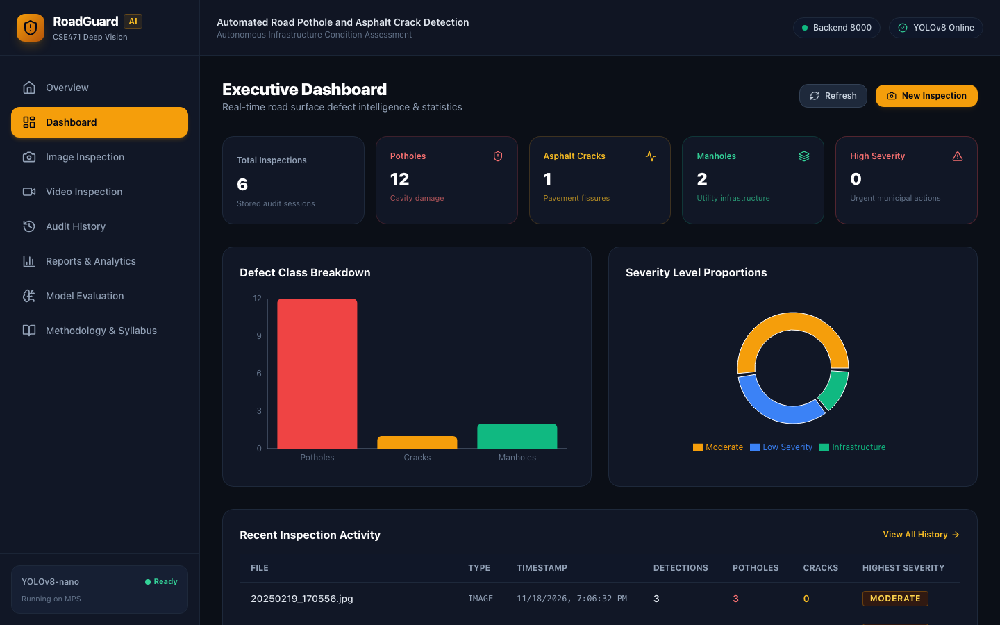
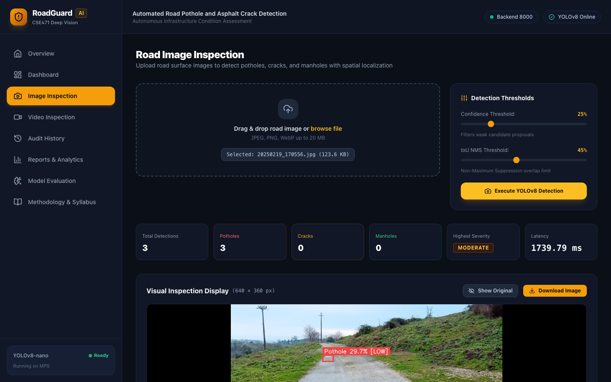
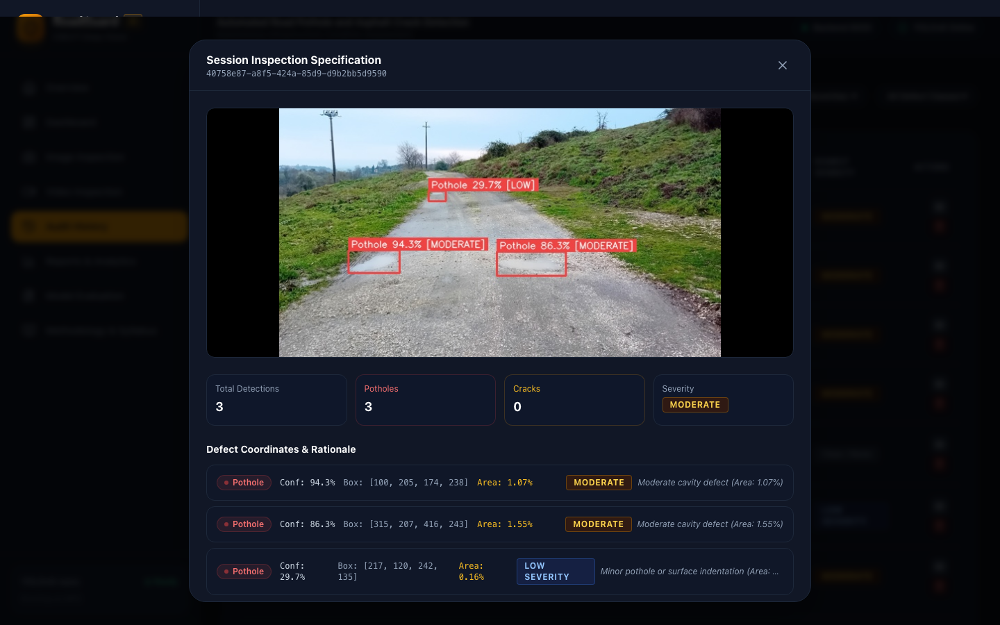
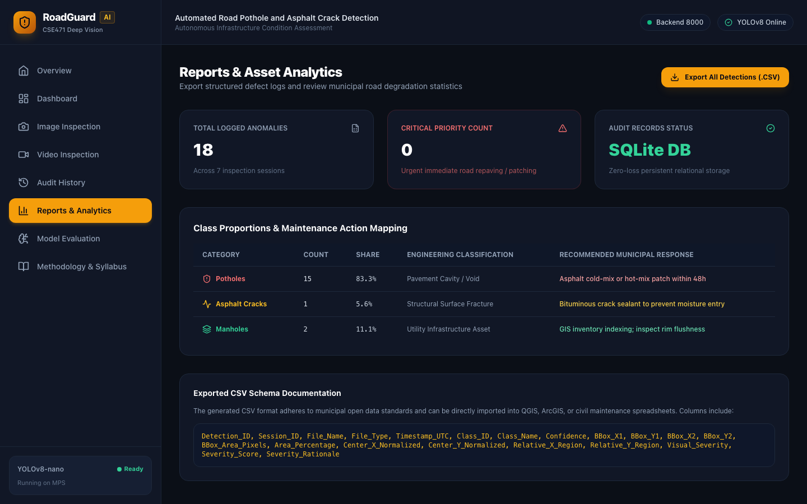

# RoadGuard AI: Automated Road Pothole and Asphalt Crack Detection for Smart Maintenance

[](https://github.com/ultralytics/ultralytics)
[](https://fastapi.tiangolo.com)
[](frontend/)
[](https://sqlite.org)

---

## 1. Executive Summary

**RoadGuard AI** is an intelligent, full-stack computer vision application engineered to automate municipal road pavement inspection. The system localizes road hazards—specifically **Potholes (Class 0)**, **Asphalt Cracks (Class 1)**, and **Manholes (Class 2)**—using a fine-tuned **Ultralytics YOLOv8-nano** single-stage object detector.

The application is optimized for real-time edge execution on standard consumer hardware (including Apple Silicon Metal Performance Shaders and modern multi-core CPUs) without requiring external cloud inference subscriptions or proprietary APIs.

```text
       [ Road Dashcam / Smartphone Media ]
                       │
                       ▼
       ┌───────────────────────────────┐
       │   FastAPI Local Backend API   │
       │   (OpenCV + PyTorch / MPS)    │
       └───────────────┬───────────────┘
                       │
         ┌─────────────┴─────────────┐
         ▼                           ▼
┌──────────────────┐       ┌──────────────────┐
│ YOLOv8 Inference │       │  SQLite Database │
│ Bounding Boxes & │       │ Session Logs &   │
│ Severity Engine  │       │ Defect History   │
└────────┬─────────┘       └─────────┬────────┘
         │                           │
         └─────────────┬─────────────┘
                       ▼
       ┌───────────────────────────────┐
       │  React 18 + Vite + TS Client  │
       │  (Dashboard, History, CSV)    │
       └───────────────────────────────┘
```

---

## 2. Key Features

- **Multi-Class Defect Detection:** Simultaneous identification of Potholes (Class 0) and Cracks (Class 1), with separate categorization of Manholes (Class 2 as neutral utility infrastructure).
- **Sub-Pixel Spatial Localization:** Bounding box coordinate mapping $[x_1, y_1, x_2, y_2]$, normalized centers, and pixel area percentage relative to the image frame.
- **Explainable Visual Severity Heuristic:** Class-specific deterministic severity rules (Low, Moderate, High) factoring in area percentage, crack aspect ratio, and vehicle proximity.
- **Edge-Ready Inference:** Local CPU and Apple Silicon Metal Performance Shaders (MPS) inference (~14 ms per frame).
- **Frame-by-Frame Video Streaming:** Memory-safe video analysis streaming frames sequentially via OpenCV to prevent RAM exhaustion.
- **Persistent Inspection History:** Fully searchable and filterable SQLite audit records with one-click municipal CSV reporting.

---

## 3. Application Showcase

The web interface is built with React 18, Vite, TypeScript, and Tailwind CSS:

| Live Analytics Dashboard | Single Image Defect Inspection |
| :---: | :---: |
|  |  |

| Inspection History & Dossier Modal | Reports & Asset Analytics |
| :---: | :---: |
|  |  |

*For complete desktop and mobile interface walkthroughs, consult the [docs/user-guide.md](docs/user-guide.md).*

---

## 4. Technology Stack

| Domain | Technologies |
| :--- | :--- |
| **Deep Learning & Vision** | Ultralytics YOLOv8-nano (`yolov8n.pt`), PyTorch 2.x, OpenCV (`opencv-python-headless`), NumPy, PIL |
| **Backend & REST API** | FastAPI, Uvicorn, Pydantic v2, SQLAlchemy ORM |
| **Database** | SQLite 3 (`roadguard.db`) |
| **Frontend Framework** | React 18, Vite 5, TypeScript 5, Tailwind CSS |
| **Data Visualization** | Recharts, Lucide React |
| **Model Training** | Google Colab (Authoritative notebook: `notebooks/RoadGuard_AI_YOLOv8_Training.ipynb`) |
| **Quality Assurance** | Pytest, Automated Schema Validation |

---

## 5. Dataset & Attribution

RoadGuard AI is trained on the *Road Damage Dataset: Potholes, Cracks and Manholes* by Lorenzo Arcioni et al.
- **Total Images:** 2,009 road surface images (640 × 360 native resolution).
- **Annotated Instances:** 4,737 total instances (1,261 Potholes, 2,519 Cracks, 957 Manholes).
- **Authoritative Split:** 80% Train (1,607 images), 10% Validation (200 images), 10% Held-Out Test (202 images) with fixed random seed 42.
- **Zenodo DOI:** [10.5281/zenodo.17834373](https://doi.org/10.5281/zenodo.17834373)
- **Publication Citation:**
  > Giordani, E., Arcioni, L., Gil-Martín, M. et al. (2026). *Real-world road damage dataset with potholes, cracks, and maintenance holes.* Scientific Reports, 16, 15318. https://doi.org/10.1038/s41598-026-46679-4
- For dataset download and preparation instructions, see [docs/dataset-and-attribution.md](docs/dataset-and-attribution.md).

---

## 6. Empirical Model Benchmarks

The model loaded by the application (`artifacts/models/best.pt`) was trained and evaluated in the authoritative training notebook (`notebooks/RoadGuard_AI_YOLOv8_Training.ipynb`).

### Test Split Performance (202 Held-Out Road Images):
| Evaluation Metric | Overall Value | Pothole (Class 0) | Crack (Class 1) | Manhole (Class 2) |
| :--- | :---: | :---: | :---: | :---: |
| **mAP@50** | **45.96%** | **40.44%** | **31.58%** | **65.87%** |
| **mAP@50-95** | **20.03%** | 18.21% | 12.45% | 29.43% |
| **Precision ($P$)** | **59.53%** | **65.41%** | **52.60%** | **60.59%** |
| **Recall ($R$)** | **45.76%** | **34.88%** | **30.67%** | **71.74%** |
| **Harmonic Mean ($F_1$)** | **51.75%** | **45.49%** | **38.75%** | **65.70%** |
| **Inference Latency** | **14.09 ms** | *(Apple M2 MPS)* | **~70.9 FPS** | *(Real-Time)* |

All evaluation artifacts (`evaluation_metrics.json`, `results.csv`, `results.png`, `confusion_matrix.png`) are located in `artifacts/metrics/`.

> **Methodological Caveat on Dataset Splitting:** The 45.96% mAP@50 benchmark reflects evaluation on the original 80/10/10 random split (202 held-out test images) generated during the baseline training run. Post-training diagnostics identified that continuous vehicle dashcam video sequences can cause frames from the same recording burst to appear across different random partitions, introducing potential recording-level leakage. Subsequent research experiments exploring clean recording-level grouping are maintained separately in research archives and are not conflated with this baseline deployment model.

---

## 7. Quick Start & Local Execution

### Prerequisites
- macOS (Apple Silicon or Intel), Linux, or Windows (WSL2).
- Python 3.11 installed.
- Node.js (v18+) and npm.

### Quick Launch
```bash
# Clone repository
git clone https://github.com/Shivam-0212/roadguard-ai.git
cd roadguard-ai

# Make scripts executable and start
chmod +x start.sh run_backend.sh run_frontend.sh
./start.sh
```

Alternatively, run backend and frontend in separate terminals:

**Terminal 1 — Backend:**
```bash
python3.11 -m venv .venv
source .venv/bin/activate
pip install -r backend/requirements.txt
./run_backend.sh
```
*Backend runs on `http://localhost:8000` (API Docs: `http://localhost:8000/docs`)*

**Terminal 2 — Frontend:**
```bash
cd frontend
npm install
cd ..
./run_frontend.sh
```
*Frontend runs on `http://localhost:5173`*

For comprehensive setup details, consult [docs/setup.md](docs/setup.md).

---

## 8. REST API Overview

FastAPI serves interactive OpenAPI documentation at `http://localhost:8000/docs`.

| Method | Endpoint | Description |
| :--- | :--- | :--- |
| `GET` | `/api/health` | Service health status and uptime. |
| `GET` | `/api/model/status` | Model status, active device (MPS/CPU/CUDA), and classes. |
| `GET` | `/api/model/metrics` | Model evaluation metrics (Precision, Recall, mAP). |
| `GET` | `/api/dashboard/summary` | Aggregated defect counts, class breakdown, and recent activity. |
| `POST`| `/api/detections/image` | Upload image, run inference, calculate severity, store session. |
| `POST`| `/api/detections/video` | Upload video, sample frames, render bounding boxes, encode MP4. |
| `GET` | `/api/detections` | Paginated inspection history with severity and class filters. |
| `GET` | `/api/detections/{id}` | Detailed session view with individual defect coordinates. |
| `DELETE`| `/api/detections/{id}` | Permanently delete an inspection session. |
| `GET` | `/api/reports/detections.csv` | Export all logged detections as a municipal CSV file. |

---

## 9. Automated Testing & Verification

Run backend unit tests:
```bash
source .venv/bin/activate
pytest backend/tests/ -v
```
*(All 15 tests pass covering health, model loading, detection API, coordinate math, severity engine, and SQLite repository).*

Run frontend build verification:
```bash
cd frontend && npm run build && cd ..
```

---

## 10. Technical Documentation Index

- **[ARCHITECTURE.md](ARCHITECTURE.md):** System architecture, data flow sequences, and database ER diagrams.
- **[CHANGELOG.md](CHANGELOG.md):** Project release history and version notes.
- **[docs/setup.md](docs/setup.md):** Step-by-step installation, checkpoint verification, and troubleshooting.
- **[docs/how-it-works.md](docs/how-it-works.md):** Detailed walkthrough of the image ingestion, YOLOv8 inference, and severity heuristics.
- **[docs/user-guide.md](docs/user-guide.md):** Practical user manual for navigating the web application and exporting reports.
- **[docs/dataset-and-attribution.md](docs/dataset-and-attribution.md):** Dataset composition, licensing, and preparation instructions.
- **[notebooks/RoadGuard_AI_YOLOv8_Training.ipynb](notebooks/RoadGuard_AI_YOLOv8_Training.ipynb):** Authoritative training notebook for YOLOv8-nano.

---

## 11. Engineering Limitations & Future Scope

- **Visual Severity is Heuristic:** The severity score is an explainable visual proxy based on pixel area, aspect ratio, and camera proximity, not a geotechnical core-drill assessment.
- **2D Monocular Camera Constraints:** Lacks physical 3D cavity depth measurements ($Z$-axis millimeter depth). Future work could integrate stereo camera or LiDAR sensor fusion.
- **Geographic Domain Transfer:** The dataset was collected in Rome/Sacrofano, Italy. Adaptation to Indian road environments requires domain transfer fine-tuning.

---

## 12. Authors & Acknowledgments

- **Lead AI/ML Engineer:** Shivam Rai
- **Academic Course:** CSE471 — Deep Learning for Computer Vision
- **Dataset Authors:** Lorenzo Arcioni, Eugenio Giordani, and collaborators for providing the open-source Road Damage Dataset.
